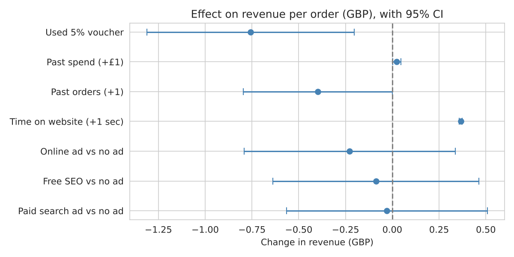
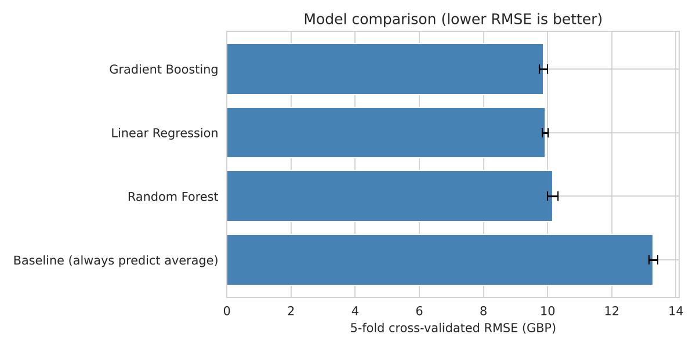
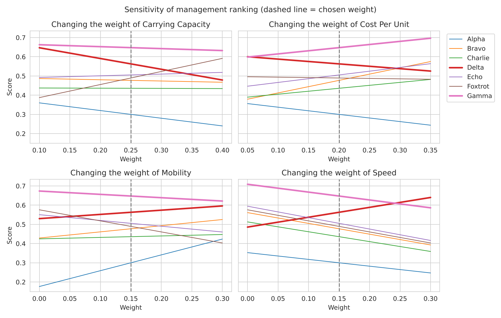

# SweetAroma: Revenue Drivers & Warehouse Robot Selection

Business analytics case study for **SweetAroma**, a UK online perfume retailer. It answers two business questions:

1. **What makes customers spend more, and can we predict a new customer's order value?** (statistics and machine learning on 10,000 orders)
2. **Which warehouse robot should the company buy?** (multi-criteria decision analysis with sensitivity analysis)

*Python · pandas · scipy · statsmodels · scikit-learn · matplotlib/seaborn*

---

## Key findings

| Question | Answer |
|---|---|
| Strongest revenue driver | **Time on website.** Each extra 10 seconds adds about **£3.66** per order (r = 0.67, p < 0.001) |
| Do ad channels change order value? | **No.** Paid search, free SEO, online ads and no ad all average about £55 (ANOVA p = 0.97) |
| Does the 5% voucher increase spend? | **No.** Voucher orders are about **£0.76 smaller** when other factors are held constant (p = 0.007) |
| Best prediction model | **Linear Regression.** CV RMSE **£9.92**, which is **25% better** than the baseline; as accurate as Gradient Boosting (£9.86) and easier to explain |
| Robot to buy | **Gamma.** Ranked first for both management (0.65) and the technical team (0.80); first in 9 of 14 sensitivity tests |



---

## Part 1: Revenue analysis ([notebook](notebooks/01_revenue_analysis.ipynb))

**Data:** 10,000 July 2025 orders. 581 rows (about 6%) had missing values and were dropped, leaving 9,419 orders.

**Statistical tests**
- One-way ANOVA across 4 ad channels: F = 0.086, p = 0.968. The channels do not differ in average order value.
- Welch t-test, voucher vs no voucher: £54.93 vs £55.57, p = 0.083 (borderline on its own; significant once other factors are controlled).

**Driver model (OLS, R² = 0.44)**

| Factor | Effect on revenue | p-value |
|---|---|---|
| Time on website (+1 sec) | +£0.37 | < 0.001 |
| Used 5% voucher | −£0.76 | 0.007 |
| Past spend (+£1) | +£0.02 | 0.026 |
| Past orders (+1) | −£0.40 | 0.050 |
| Ad channel (vs no ad) | not significant | > 0.4 |

**Model comparison (5-fold cross-validation)**

| Model | CV RMSE (£) |
|---|---|
| Gradient Boosting | 9.86 ± 0.13 |
| **Linear Regression (chosen)** | **9.92 ± 0.09** |
| Random Forest | 10.16 ± 0.16 |
| Baseline (always predict the mean) | 13.30 ± 0.14 |

On a hold-out test set the RMSE was £9.89. The final model predicts revenue for 20 new customers ([predictions](data/predictions_20_customers.csv)), from £16 to £67 per order.



---

## Part 2: Robot selection with MCDA ([notebook](notebooks/02_robot_selection_mcda.ipynb))

Seven prototypes are scored on 7 criteria: carrying capacity, battery, speed, mobility, aesthetic, cost and reliability.

**Method**
- Min-max normalisation. Cost is treated as a cost criterion, so lower is better.
- Weighted sum scoring with two weight sets: **management** (capacity and cost first) and **technical** (battery, cost and reliability first).
- One-way sensitivity analysis: each weight is moved ±15 percentage points and the other weights are rescaled in proportion.

| Robot | Management score | Technical score |
|---|---|---|
| **Gamma** | **0.648** | **0.798** |
| Delta | 0.563 | 0.714 |
| Echo | 0.505 | 0.678 |
| Foxtrot | 0.489 | 0.535 |
| Bravo | 0.477 | 0.465 |
| Charlie | 0.436 | 0.512 |
| Alpha | 0.300 | 0.300 |



**Robustness:** Gamma stays first in 9 of 14 sensitivity tests. Only **Delta** can overtake it, and only if cost becomes much less important (management cost weight below 0.05) or speed becomes much more important (above 0.26). Gamma is the safe choice, especially on a budget (£5,000 vs £8,000 per unit).

---

## Business recommendations

1. **Invest in keeping customers on the site longer** (product guides, recommendations, better product pages). This is the clearest lever for basket size.
2. **Judge ad spend on customer acquisition, not order value.** Channels bring customers who spend the same amount.
3. **Retarget the 5% voucher** to new-customer acquisition instead of using it for everyone, since it does not raise spend.
4. **Use the revenue model to rank customers** for targeted marketing. It is about £10 off per order, so it is good for ranking but not for exact forecasts.
5. **Buy Gamma robots** for warehouse scaling; keep Delta as the alternative if speed becomes critical.

**Limitations:** one month of data (no seasonality); time on site may be partly a result of purchase intent, so an A/B test would confirm the effect; MCDA weights are an interpretation of written priorities (AHP with stakeholders would make them more objective).

---

## Repository structure

```
├── data/
│   ├── order_july25.csv              # 10,000 orders
│   ├── new_customer25.csv            # 20 customers to predict
│   ├── predictions_20_customers.csv  # model output
│   ├── Robot_Info.csv                # robot specifications
│   └── Management_Priority.xlsx      # management's stated priorities
├── notebooks/
│   ├── 01_revenue_analysis.ipynb
│   └── 02_robot_selection_mcda.ipynb
├── images/                           # charts used in this README
└── requirements.txt
```

## How to run

```bash
pip install -r requirements.txt
jupyter notebook notebooks/
```

---

*Developed from my coursework for LUBS5308M Business Analytics and Decision Science (MSc Data Science & Analytics, University of Leeds), extended with model comparison, hypothesis testing and sensitivity analysis. The dataset is a teaching dataset provided for the module.*

**Brijdeep Choudhary** · [LinkedIn](https://www.linkedin.com/in/brijdeep-choudhary-26b706395) · [GitHub](https://github.com/mrchoudharybrij)
